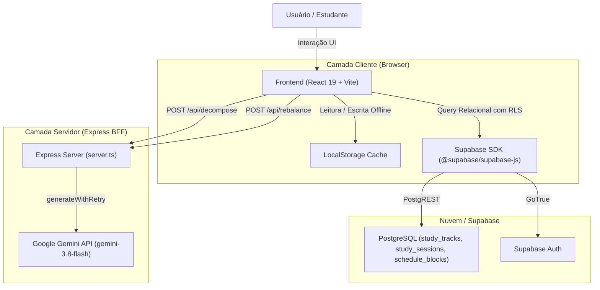
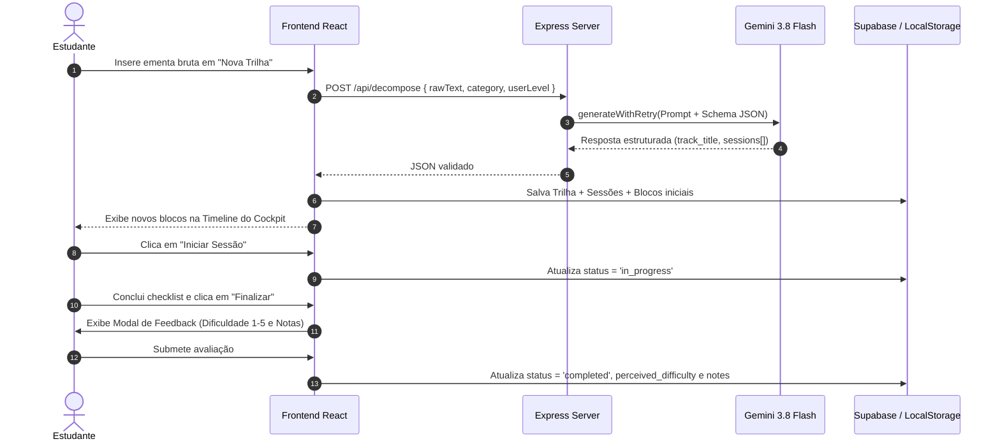

# Arquitetura do Sistema - StudyPilot (Cadence)

Este documento detalha o mapa de domínios, entidades de dados, fluxos de comunicação e arquitetura técnica do **StudyPilot (Cadence)**.

---

## 1. Visão Arquitetural

O sistema é construído sobre uma arquitetura híbrida de alto desempenho composta por:
1. **Frontend SPA**: React 19 + TypeScript + Vite servido como Single Page Application com Tailwind CSS v4.
2. **BFF / Servidor de Aplicação**: Node.js/Express (`server.ts`) atuando como proxy seguro para o Google Gemini API e middleware de assets.
3. **Persistência Relacional**: Supabase (PostgreSQL + PostgREST + Auth).
4. **Camada de Cache / Offline Fallback**: `localStorage` gerenciado por `storageService.ts` com capacidade de importação e exportação de backups JSON.



---

## 2. Mapa de Domínios e Entidades

O modelo relacional central é composto por três entidades principais ligadas por integridade referencial:

### A. `StudyTrack` (Trilha de Estudos)
Representa uma disciplina, projeto de pesquisa ou tema macro de capacitação técnica.
- `id` (UUID): Identificador único da trilha.
- `user_id` (String / UUID): Identificador do usuário proprietário.
- `title` (String): Título conciso da trilha (ex: *Pesquisa Operacional & Otimização Linear*).
- `category` (String): Categoria técnica (ex: *Engenharia de Produção*, *Software & TI*).
- `overview` (String): Descrição técnica do escopo e objetivos.
- `color_hex` (String): Cor temática em hexadecimal para diferenciação visual na timeline.
- `is_archived` (Boolean): Flag de arquivamento.
- `created_at` / `updated_at` (Timestamps).

### B. `StudySession` (Sessão Atômica de Estudo)
Unidade atômica indivisível de trabalho cognitivo (de 30 a 90 minutos).
- `id` (UUID): Identificador único da sessão.
- `track_id` (UUID -> `StudyTrack.id`): Vínculo com a trilha de origem.
- `user_id` (String / UUID): Identificador do usuário proprietário.
- `sequence_order` (Integer): Ordem pedagógica de execução (1, 2, 3...).
- `title` (String): Título operacional da sessão.
- `session_type` (Enum): `'theory' | 'practice' | 'review' | 'project'`.
- `estimated_duration_min` (Integer): Duração planejada em minutos.
- `cognitive_effort` (Enum): `'low' | 'medium' | 'high'`.
- `learning_goals` (Array de Strings): Metas objetivas de verificação de aprendizagem.
- `recommended_approach` (String): Roteiro de foco prático para evitar dispersão mental.
- `status` (Enum): `'todo' | 'in_progress' | 'completed' | 'skipped'`.
- `perceived_difficulty` (Integer, 1-5, Opcional): Feedback pós-execução.
- `notes` (String, Opcional): Anotações do estudante.

### C. `ScheduleBlock` (Bloco de Agendamento na Timeline)
Alocação temporal da sessão na grade semanal segundo critérios do PCP.
- `id` (UUID): Identificador único do agendamento.
- `user_id` (String / UUID): Identificador do usuário.
- `session_id` (UUID -> `StudySession.id`): Sessão vinculada.
- `target_date` (String YYYY-MM-DD): Data de execução.
- `target_period` (Enum): `'morning' | 'afternoon' | 'evening' | 'night'`.
- `priority_rank` (Integer, 1 a 5): Nível de prioridade na esteira de produção.
- `ai_justification` (String): Parecer técnico da IA justificando o agendamento.
- `is_rescheduled` (Boolean): Indica se o bloco sofreu replanejamento de capacidade.

### D. `EnrichedScheduleBlock` (Tipo Composto para Renderização)
Junção relacional aninhada consumida pela interface:
```typescript
export interface EnrichedScheduleBlock extends ScheduleBlock {
  session: StudySession;
  track: StudyTrack;
}
```

---

## 3. Fluxo de Dados e Ciclo de Vida da Sessão



---

## 4. Política de Sincronização e Fallback

1. **Consulta Inicial (`fetchUserScheduleBlocks`)**:
   - Tenta consulta relacional aninhada no Supabase via PostgREST.
   - Caso o Supabase falhe ou as credenciais estejam ausentes, carrega do `localStorage`.
   - Se o `localStorage` estiver vazio, inicializa com o dataset de mock homologado (`mockEnrichedScheduleBlocks`).

2. **Atualização Reativa**:
   - Mutações de estado primeiro atualizam a memória React e gravam em `localStorage` (garantindo resposta instantânea de UI / *optimistic update*).
   - Em segundo plano, dispara chamadas assíncronas ao Supabase caso o cliente esteja conectado.
